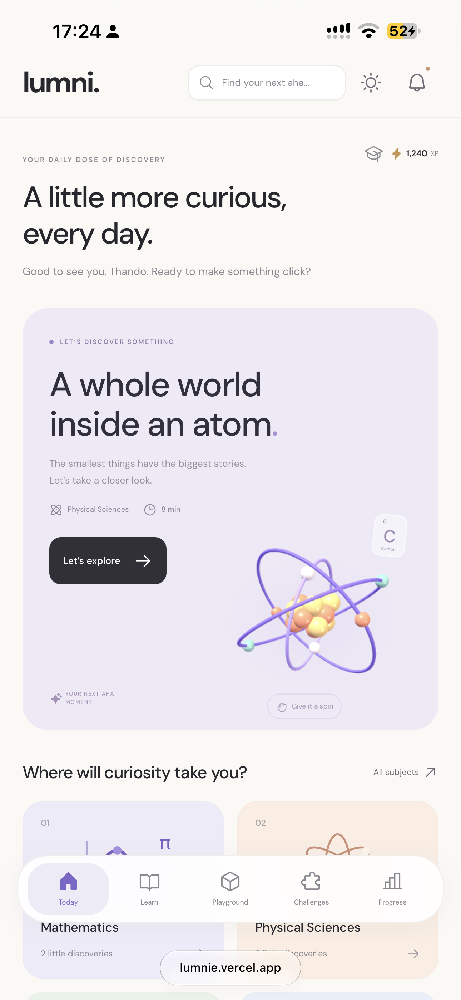
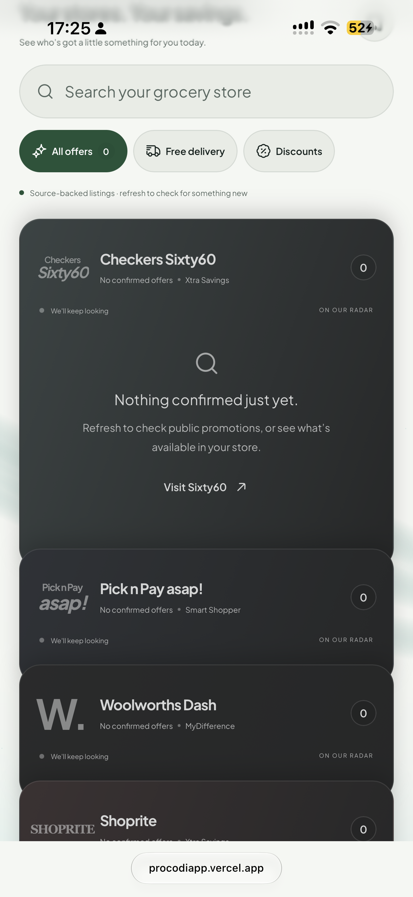
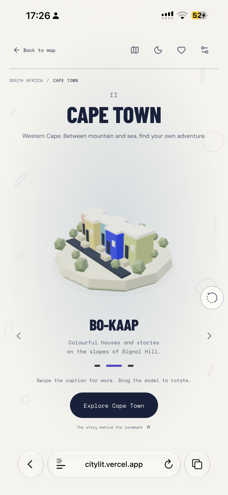
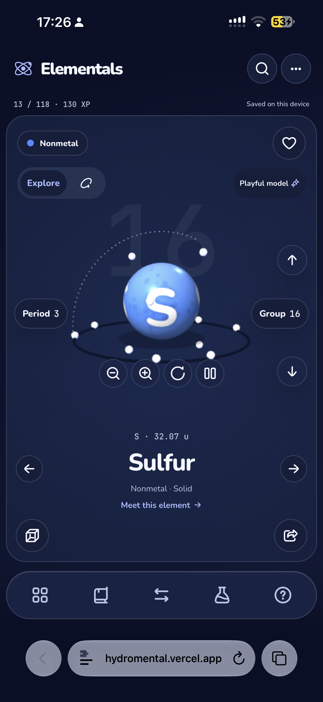

# Hi, I'm Themba 👋

**Frontend Developer · React · Next.js · TypeScript · UI/UX**

I'm a South African frontend developer with **4+ years of professional experience** building responsive web applications and turning product ideas into thoughtful, polished interfaces.

I care about **accessible UX, maintainable components, performance, and reliable delivery**. I bring both frontend engineering and UI/UX design perspectives to my work, and use AI-assisted workflows to accelerate research, implementation, and debugging without skipping testing.

**Freelance frontend developer, building websites and Shopify websites. Open to remote Frontend Developer, React Developer, Frontend Engineer and contract opportunities.**

[🌐 Portfolio](https://www.Themba.dev) · [💼 LinkedIn](https://www.linkedin.com/in/themba-p) · [✉️ Email](mailto:me@themba.dev)

## What I work with

- **Frontend:** React, Next.js, TypeScript, JavaScript, HTML, CSS
- **UI engineering:** Tailwind CSS, shadcn/ui, Material UI, responsive design, Motion
- **Data & tooling:** TanStack Query (React Query), Vite, Git, GitHub
- **Testing & quality:** Playwright, Vitest, Storybook
- **AI-assisted workflows:** Gemini, DeepSeek, Kimi, OpenCode, Cline

## Selected projects

A selection of my mobile-first interfaces and interactive web applications. Click any screenshot to explore the live experience.

<table>
  <tr>
    <td width="50%" align="center" valign="top">
      
       <strong>Lumnie</strong> 
      Curiosity-driven learning and discovery experience. 
      <a href="https://lumnie.vercel.app">Live demo</a> · <a href="https://github.com/thembaxx/lumnie">Source</a>
    </td>
    <td width="50%" align="center" valign="top">
      
       <strong>ProcodiApp</strong> 
      Grocery offers discovery and comparison interface. 
      <a href="https://procodiapp.vercel.app/?design=wallet">Live demo</a> · <a href="https://github.com/thembaxx/procodiapp">Source</a>
    </td>
  </tr>
  <tr>
    <td width="50%" align="center" valign="top">
      
       <strong>CityLit</strong> 
      Interactive city and landmark exploration. 
      <a href="https://citylit.vercel.app">Live demo</a> · <a href="https://github.com/thembaxx/citylit">Source</a>
    </td>
    <td width="50%" align="center" valign="top">
      
       <strong>Hydromental</strong> 
      Interactive periodic-table learning experience. 
      <a href="https://hydromental.vercel.app">Live demo</a> · <a href="https://github.com/thembaxx/hydromental">Source</a>
    </td>
  </tr>
</table>

## Experience

**Frontend Developer · RattleHub** — Nov 2024–Present  
Designing, prototyping, building, and testing modern frontend experiences in an early-stage product environment. Working with React, TypeScript, Tailwind CSS, component systems, and AI-assisted development workflows.

**Frontend Developer · HeyCarter** — Apr 2022–Sep 2024  
Promoted from Junior Frontend Developer. Built internal applications, Zoho CRM widgets, and public-facing websites using React and modern frontend tooling.

## Let's connect

I'm interested in collaborating on meaningful products and joining teams that value clean implementation, strong UX, and continuous learning.

📧 **me@themba.dev** · [LinkedIn](https://www.linkedin.com/in/themba-p) · [Portfolio](https://www.Themba.dev)

## More engineering work

| Project | Focus | Status and evidence |
| --- | --- | --- |
| [Leesmaat](https://github.com/thembaxx/leesmaat) | English and Afrikaans literacy | Offline reading archive; optional Google sync |
| [Nuzzle](https://github.com/thembaxx/mypets) | Daily pet-care companion | Local care routines and a labelled sample experience |
| [HomeBuyer](https://github.com/thembaxx/homebuyer) | South African property due diligence | Editable cost assumptions and sourced enrichment; estimates have explicit limits |
| [StokvelOS](https://github.com/thembaxx/stockvel) | Stokvel administration | Prototype and financial foundation; production workflows remain incomplete |
| [MatricMaster AI](https://github.com/thembaxx/matricmaster-ai) | Grade 12 study tooling | AI and database integrations require configuration |

Project READMEs document implementation details, setup requirements and limitations. Lumnie (`lumnie`) and Lumni (`lumni`) are separate repositories.
